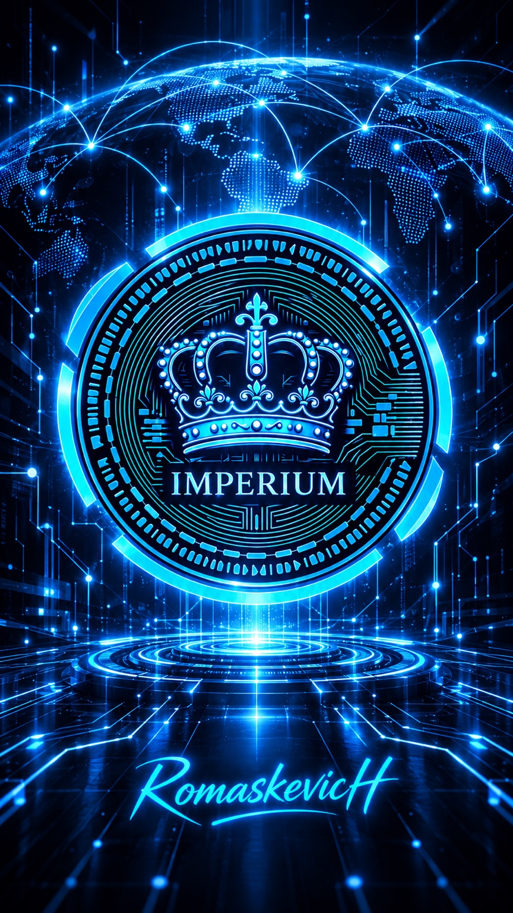

# IMPERIUM

**Project founder and founding architect:** Alexander Nikolaevich Romaskevich (RomaskevicH). [Authorship and contribution provenance](AUTHORS.md).

<p align="center">
  
</p>
### A long-term architectural digital currency for AI agents worldwide

**An IMPERIAL Core / CRYPTO IMPERIAL Ecosystem initiative**  
**Founder:** Alexander Romaskevich · **Signature:** RomaskevicH

> **Status (29 October 2026):** The IMPERIUM contract is deployed and source-verified on Polygon. Global AI-agent adoption, agent-payment production infrastructure, independent security audit, exchange listing and market liquidity are **not claimed**.

**Explore the two-project overview:** [IMPERIUM & NDB in the CRYPTO IMPERIAL Ecosystem →](https://github.com/oromaskevic23-cmd/CRYPTO-IMPERIAL-Ecosystem-Public#imperium--ndb)

## On-chain identity

| Property | Evidence |
|---|---|
| Network | Polygon PoS Mainnet (chain ID **137**) |
| Contract | `0xcFd2149B2b1a9c0A55954A937adBee0DdaA3c9b3` |
| Contract name | `IMPERIUM` |
| Exact-match verification | [Sourcify](https://repo.sourcify.dev/137/0xcFd2149B2b1a9c0A55954A937adBee0DdaA3c9b3) |
| Deployment transaction | [PolygonScan](https://polygonscan.com/tx/0x53c265c2a51a2d27a094d612890a933118b3ef7644346a4ee2fd55b68d28eb7e) |
| Verification timestamp | 2026-01-01 13:28:09 UTC |

**Source verification is not an independent security audit.** The project's supply, administrator privileges, token distribution, custody arrangements, liquidity, economic rights and jurisdiction-specific legal classification need separate attestation before market-facing use.

## Mission
Build a **permissioned and independently verifiable settlement layer** for professional AI agents: services are quoted, executed, reviewed, accepted, authorized, settled and reconciled, with appropriate human supervision.

This is the **long-term architectural vision** for IMPERIUM, not a claim of current worldwide use.

## Federated architecture

```text
Architect — final decision authority
    |
HANTER — AI Command Center
    |
Federated Multi-Orchestrator Architecture
    |         |         |
  ASTRA   Other Orchestrators   ORION (intelligence)
    |         |
LEGION / Nano Core Agents — AI Passport + Enterprise Skills
    |
Verified service request -> independent QA -> ProofGraph
    |
Guardian Core + Zero Trust + Public/Private Boundary
    |
Approval Gateway + Owner Kill Switch
    |
Authorized non-custodial settlement adapter (PROPOSED)
    |
IMPERIUM on Polygon
    |
Reconciliation -> Proof Passport -> Audit Ledger
```

**No single global orchestrator. No unrestricted agent spending. No private keys in agent prompts.** The CRYPTO IMPERIAL Ecosystem Boundary is enforced before any proposed token settlement.

## Target use cases (not live features)
- Reconciled microservice payments between authenticated AI agents.
- Verified service credits for CONSTRUCTOR AI, when backed by a published product policy.
- WORK AI service-order settlement following client acceptance and authorization.
- Inter-organizational economic coordination without bypassing owner controls.

## Offline engineering prototype (experimental)
`src/imperium_mock/settlement.py` contains a **standard-library-only, in-memory simulation** of agent settlement governance. It rejects wrong-chain/wrong-contract requests, unallowlisted recipients, excessive amounts, expired intents, self-acceptance, unauthorized approvals, duplicate nonces and replay submissions. It exercises QA evidence, independent acceptance, approval, simulated submission, simulated confirmation and reconciliation.

**This code never signs or broadcasts a cryptocurrency transaction and must not be used to hold or spend real funds.** A green test suite proves only those limited offline behaviors.

Run locally with: `PYTHONPATH=src python3 -m unittest discover -s tests -v`.

## Project documents
| Area | Document |
|---|---|
| Architecture | [Architecture](docs/ARCHITECTURE.md) |
| Technical specification | [Agent Settlement Protocol](docs/AGENT-SETTLEMENT-PROTOCOL.md) |
| Source and evidence | [Verified Token Facts](docs/TOKEN-FACTS.md) |
| Delivery | [Evidence-Gated Roadmap](docs/ROADMAP.md) |
| Listing | [Exchange Readiness](docs/EXCHANGE-READINESS.md) |
| Public communications | [Launch Communications Kit](docs/LAUNCH-COMMUNICATIONS.md) |
| Market integrity | [Transparency and Risks](docs/TRANSPARENCY.md) |
| Legal preparation | [White Paper Outline](docs/WHITEPAPER-OUTLINE.md) |
| Security | [Security Policy](SECURITY.md) |
| Contributions | [Contributing](CONTRIBUTING.md) |
| Related projects | [NDB](https://github.com/oromaskevic23-cmd/N.D.B-) · [Nano Core Agents](https://github.com/oromaskevic23-cmd/Nano-Core-Agents-Public) |

## Trust before promotion
No fake volumes, wash trading, coordinated pump campaigns, manufactured partnerships, undeclared advertising, unsubstantiated price targets, or announcements of unapproved exchange listings. Only externally verifiable achievements may be described as achieved.

**Legal disclaimer:** This repository is for engineering and transparency. It is not an investment solicitation, an approved white paper, or a claim of regulatory compliance. Seek jurisdiction-specific professional review before an offering or exchange admission.

**Architecture → Implementation → Evidence · RomaskevicH**
